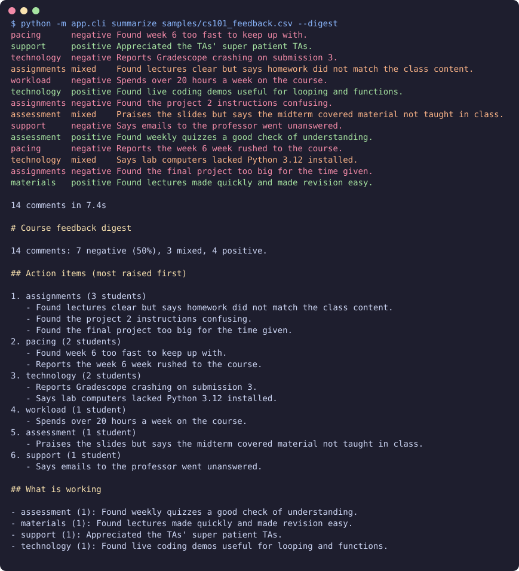

# Student Feedback Summarizer

[](https://ask.thili.ai/b/kgqfvkcj6d)
[](https://github.com/Sky00raider/student-feedback-summarizer/actions/workflows/ci.yml)

Instructors upload their end-of-term student comments. A distilgpt2 with a hand-written LoRA adapter turns each comment into one structured line, `topic | sentiment | one-line summary`. A course digest then ranks action items by how many students raised them, so the most common complaint comes first. Everything runs in a Streamlit UI, which also lets the instructor rate each summary from 1 to 5 stars.

> **Headline.** On 48 freeform comments written independently of the training templates, topic accuracy is 93.8% for the LoRA model, against 64.6% for a keyword baseline and 2.1% for few-shot distilgpt2 without LoRA. ROUGE-L is 31.5 against 25.2. The adapter is 1,179,648 trainable parameters (1.42% of 83.1M), a 4.6 MB file, trained in about 9 minutes on a laptop CPU. The merged model gives identical outputs on all 168 test comments.



<sub>Real output of `python -m app.cli summarize samples/cs101_feedback.csv --digest`, rendered by `python scripts/render_demo.py`.</sub>

## Quick start

You need Python 3.12.

```bash
python3.12 -m venv .venv && source .venv/bin/activate
pip install -r requirements.txt
streamlit run app/main.py
```

In the app, click "Use the sample CS101 survey", then Summarize. The same thing from the command line:

```bash
python -m app.cli summarize samples/cs101_feedback.csv --digest
```

Run the tests with `pytest`. There are 35; they use no network, a tiny random GPT-2 and a byte tokenizer, so they finish quickly.

The trained adapter `models/adapter.pt` is committed. The first run downloads distilgpt2 (about 330 MB) from Hugging Face. No API key is needed: the `.env` file and `app/llm.py` chat settings from the starter are not used by the summarizer.

## What it does for an instructor

- Each comment becomes a structured line: topic, sentiment (negative, positive or mixed) and a one-line summary.
- The digest lists action items ranked by the number of students who raised them, what is working, and a "read these yourself" list. That list holds comments the model output could not be parsed for, or whose summary has 3 or more words not found in the comment.
- A topic x sentiment bar chart shows where the feedback is concentrated.
- PII is redacted before the model sees any text: emails, phone numbers, student IDs and "my name is X". This is on by default.
- Upload formats: CSV (auto-detects a comment, feedback, response or text column, otherwise uses the wordiest column), TXT (one comment per line or per paragraph) and JSON or JSONL.
- The digest downloads as Markdown.
- Each summary can be rated 1 to 5 stars. Ratings are stored in `data/app.json`. An "Instructor ratings" tab shows the average by topic and lists the lowest-rated summaries as candidates for new training examples. Ratings export as JSON.
- Under each summary, a "words not found in the comment" hint flags possible hallucination.
- A repetition guard collapses "X but X" summaries into a single clause.

## How it works

1. **Data.** A template generator in `app/core.py` produces comments over 8 topics (pacing, workload, lectures, assignments, assessment, materials, support, technology) and 3 sentiments. A mixed comment is praise plus a complaint, and its topic is the complaint. Each topic has 5 negative and 5 positive claims, each paired with a summary phrase. Comments are rendered in 7 styles: formal, casual, emphatic, terse, rambling, lowercase and typos. The last claim of every list and two whole courses (Microeconomics, Data Structures) are held out for the test split. The split is 1,200 train, 60 validation and 120 test.

   Template text is easy to learn and easy to overfit, so there are two more sources. 320 varied training comments were written separately (`dataset/diverse_a.jsonl` and `dataset/diverse_b.jsonl`: 40 per topic, in many styles and courses). 48 freeform test comments were written independently of both (`dataset/freeform.jsonl`: 6 per topic, 16 per sentiment) and checked not to overlap with the training data. The final training mix, `dataset/mix`, has 600 template and 288 varied examples, with the other 32 varied examples held for validation.

2. **LoRA by hand, no peft.** `LoRALinear` wraps a GPT-2 `Conv1D` layer and computes `y = base(x) + (alpha/r) x A^T B^T`. A is random times 0.01 and B is zero, so the wrapped model starts identical to the base. The adapter is injected into `c_attn`, `c_proj` and `c_fc` of all 6 blocks (24 layers) with r=16 and alpha=32. Only the A and B matrices train.

3. **Training.** The prompt is `Feedback: <comment>\nSummary:` and the target is ` topic | sentiment | summary<eos>`. The loss is masked to the target only. Optimizer is AdamW at lr 2e-3 with warmup and linear decay, for 3 epochs at batch size 8. Training took 528 s on a Ryzen laptop CPU.

4. **Inference.** Batched greedy decoding with left padding. The output is parsed and validated against the `topic | sentiment | summary` format; anything that does not parse is flagged for the instructor.

5. **Merging.** `W' = W + (alpha/r) B@A`, transposed for `Conv1D`. `python -m app.cli merge` writes `models/merged/`, a 331 MB plain GPT-2 checkpoint that loads with `AutoModelForCausalLM` and needs no LoRA code.

## Milestones

- [x] **1. Prepare a small dataset of synthetic student feedback and summary pairs.**
      Done: `make_example`, `make_dataset`, `mix_datasets` and `load_diverse` in `app/core.py`; the files in `dataset/`.
- [x] **2. Implement LoRA adapter injection and training on a pre-trained LLM (GPT-2).**
      Done: `LoRALinear`, `inject_lora`, `train_lora`, `save_adapter` and `apply_adapter` in `app/core.py`; `python -m app.cli train`.
- [x] **3. Develop a Streamlit UI to upload feedback and trigger summarization.**
      Done: `app/main.py`, built on `read_feedback`, `redact`, `Summarizer`, `build_digest` and `digest_markdown`.
- [x] **4. Evaluate the quality of generated summaries against original feedback.**
      Done: `rouge_n`, `rouge_l`, `evaluate`, `keyword_baseline` and `confusion` in `app/core.py`; `scripts/evaluate.py` writes `results/results.md`.
- [x] **5. Implement adapter merging for inference.**
      Done: `merge_lora`, `save_merged`, `max_logit_diff` and `time_generation` in `app/core.py`; `python -m app.cli merge`.

### Stretch ideas (all done)

- Hyper-parameter sweep over LoRA rank, alpha and training data: `scripts/sweep.py` writes `results/sweep.md`.
- Expanded varied dataset: the 320 separately written comments in `dataset/`.
- Instructor ratings in the UI.

### Beyond the brief

- Course digest with action items ranked by number of students.
- PII redaction before inference.
- Hallucination hint and repetition guard.
- An issue-versus-praise metric alongside topic and sentiment accuracy.
- A command-line interface (`python -m app.cli`).
- A merged deployment checkpoint.

## Results

All numbers below come from `scripts/evaluate.py` on the 48 freeform comments and the 120 template test comments.

#### Synthetic test (held-out phrasings + courses)

| System | Topic acc % | Sentiment acc % | Issue-vs-praise acc % | ROUGE-1 | ROUGE-2 | ROUGE-L | Well-formed % | Words found in comment % | Words / summary |
|---|---:|---:|---:|---:|---:|---:|---:|---:|---:|
| Keyword baseline (no model) | 68.3 | 55.8 | 59.2 | 46.2 | 26.2 | 42.6 | 100.0 | 100.0 | 11.98 |
| distilgpt2, 3-shot prompt, no LoRA | 1.7 | 10.8 | 40.0 | 14.9 | 1.7 | 13.5 | 33.3 | 15.3 | 11.51 |
| distilgpt2 + LoRA (unmerged) | 71.7 | 88.3 | 91.7 | 41.9 | 21.3 | 40.6 | 100.0 | 81.7 | 9.95 |
| distilgpt2 + LoRA, merged | 71.7 | 88.3 | 91.7 | 41.9 | 21.3 | 40.6 | 100.0 | 81.7 | 9.95 |
| Reference summaries (upper bound) | 100.0 | 100.0 | 100.0 | 100.0 | 100.0 | 100.0 | 100.0 | 71.5 | 10.50 |

#### Freeform (48 comments written independently)

| System | Topic acc % | Sentiment acc % | Issue-vs-praise acc % | ROUGE-1 | ROUGE-2 | ROUGE-L | Well-formed % | Words found in comment % | Words / summary |
|---|---:|---:|---:|---:|---:|---:|---:|---:|---:|
| Keyword baseline (no model) | 64.6 | 62.5 | 70.8 | 30.0 | 9.6 | 25.2 | 100.0 | 100.0 | 11.35 |
| distilgpt2, 3-shot prompt, no LoRA | 2.1 | 8.3 | 35.4 | 6.5 | 0.1 | 5.2 | 27.1 | 4.0 | 8.58 |
| distilgpt2 + LoRA (unmerged) | 93.8 | 60.4 | 83.3 | 35.1 | 13.6 | 31.3 | 100.0 | 86.8 | 13.10 |
| distilgpt2 + LoRA, merged | 93.8 | 60.4 | 83.3 | 35.1 | 13.6 | 31.3 | 100.0 | 86.8 | 13.10 |
| Reference summaries (upper bound) | 100.0 | 100.0 | 100.0 | 100.0 | 100.0 | 100.0 | 100.0 | 65.4 | 14.65 |

ROUGE is F1 x 100 against the reference summary. 'Words found in comment' = share of the summary's content words that appear in the original comment (a hallucination proxy); the reference summaries paraphrase, so they score below 100 too. 'Issue-vs-praise' counts negative and mixed as one class: that is all the digest needs to decide whether a comment is an action item.

### Merging

- 24 LoRA layers merged into the weights (W' = W + alpha/r * B @ A).
- Max |logit difference| merged vs unmerged: 9.2e-05.
- Identical generated text: 120/120 on synthetic test, 48/48 on freeform.
- Latency (batch of 8, greedy, CPU): 837 ms/comment unmerged, 470 ms/comment merged.
- Adapter file 4626 KB (1,179,648 trainable parameters, 1.42% of 83,092,224); merged model = a plain distilgpt2 checkpoint.

The latency numbers were measured while other training jobs shared the laptop CPU (a second run of
`python -m app.cli merge` gave 814 vs 766 ms), so treat the speed-up as small and noisy. What merging
reliably buys is deployment: `models/merged/` is an ordinary distilgpt2 checkpoint that any
Hugging Face loader can serve, with no LoRA code and no second file.

### Sample outputs

A few real model outputs on the freeform test comments, next to the reference summaries.

Two it gets right and two it gets wrong (all eight, next to both baselines: [results/samples.md](results/samples.md)).

```text
Comment:   Textbook explanations are really clear and the practice problems at the end of chapters are great,
           but the lecture slides on Canvas are just screenshots of the book with no added content.
Reference: materials | mixed | Likes the clear textbook but says the slides are only book screenshots, offering nothing extra for revision.
LoRA:      materials | mixed | Praises clear textbook explanations but found the Canvas lecture slides incomplete.
Keywords:  materials | mixed | Textbook explanations are really clear and the practice problems at the end of chapters are great, but the lecture slides

Comment:   Love the topic and the real datasets. The weekly problem sets alone are okay but with the quiz AND the
           discussion post AND the group memo all landing in the same week, it was too much.
Reference: workload | mixed | Enjoys the real datasets but struggled when quiz, discussion post and group memo all landed in the same week.
LoRA:      workload | mixed | Liked the topic and the real datasets but found the weekly problem sets too much.

Comment:   grading is soooo random. my friend wrote basically the same essay as me and got a B+ while I got a C.
           great fairness guys, 10/10
Reference: assessment | negative | Sarcastically criticises inconsistent essay grading, citing a near-identical essay scoring higher.
LoRA:      assessment | positive | Liked the random grading essay for getting a B+ in the course.        <- missed the sarcasm

Comment:   I came in worried about keeping up since I'd been away from school for ten years, but the way the first
           month built slowly from supply and demand up to the AD-AS model made it very manageable.
Reference: pacing | positive | Appreciates the gradual first-month build from supply and demand to AD-AS, which suited a returning student.
LoRA:      pacing | mixed | Says the first month built on supply and demand but wants more than one AD-AS model.   <- "but" + template phrase
```

## Findings

1. **LoRA is what makes a small model usable at all.** distilgpt2 with three solved examples in its
   prompt (no training) produces the `topic | sentiment | summary` format for 27% of freeform comments and
   names the right topic for 2%. Training 1.4% of the weights gives 100% well-formed output and 93.8% topic
   accuracy, 29 points above the keyword baseline.
2. **Template data alone overfits; varied data fixed it, more capacity did not.** The first adapter (r=8,
   attention only, 480 template examples) scored 47% topic accuracy on the synthetic test, below the keyword
   baseline. Going to r=16 on all linear layers with 1,200 template examples drove validation loss to 0.004
   but freeform topic accuracy stayed at the baseline's 64.6%, and its summaries reused template phrases on
   unrelated comments. Adding 288 separately written varied comments (and training on fewer template ones)
   lifted freeform topic accuracy from 64.6% to 93.8% and ROUGE-L from 25.8 to 31.3.
3. **Sentiment: "mixed" is over-predicted.** On freeform, 11 of 16 negative comments came out as mixed. In
   the template data the only multi-claim comments are mixed ones, so long multi-sentence complaints look
   mixed to the model. Exact sentiment accuracy (60.4%) is therefore slightly below the keyword baseline
   (62.5%). For the digest the distinction that matters is issue vs praise (negative and mixed both become
   action items): there the model gets 83.3% against 70.8%. The remaining errors are mostly praise read as an
   issue (7 of 16 positive comments), typically praise phrased with "but" ("Heavy but fair") or a question.
4. **Summaries lean on the source, sometimes on templates.** 86.8% of the content words in the model's
   summaries appear in the comment (the reference summaries paraphrase more: 65.4%). The visible failure mode
   is a leftover template phrase such as "wants more than one lecture on ..." attached to an unrelated
   comment; sarcasm is not detected.
5. **Merging is exact.** 24 merged layers, maximum logit difference 9.2e-5, identical text on all 168 test
   comments, and the merged folder is a plain checkpoint (see above).

## LoRA sweep (stretch)

Same budget for every run: first 400 training examples, 2 epochs, lr 0.002, distilgpt2. Scores: val = 60 template + 32 varied validation comments, free = 48 independent freeform comments.

| Run | Trainable params | Train s | Val loss | Val topic % | Val sent. % | Val ROUGE-L | Free topic % | Free sent. % | Free ROUGE-L | Free words in comment % |
|---|---:|---:|---:|---:|---:|---:|---:|---:|---:|---:|
| r=2 alpha=4 | 147,456 | 166 | 1.522 | 50.0 | 63.0 | 44.2 | 43.8 | 64.6 | 27.3 | 92.3 |
| r=8 alpha=16 | 589,824 | 153 | 1.298 | 58.7 | 62.0 | 46.2 | 62.5 | 64.6 | 29.1 | 92.5 |
| r=32 alpha=64 | 2,359,296 | 1541 | 1.129 | 69.6 | 71.7 | 51.2 | 64.6 | 75.0 | 29.9 | 87.8 |
| r=8 alpha=64 | 589,824 | 173 | 1.150 | 69.6 | 68.5 | 50.2 | 58.3 | 68.8 | 29.2 | 88.3 |
| r=8 alpha=16, template data only | 589,824 | 173 | 1.431 | 58.7 | 73.9 | 47.3 | 52.1 | 60.4 | 23.7 | 79.5 |

A short, equal budget for every run (the shipped adapter trains longer: 888 examples, 3 epochs), so the
absolute numbers are lower than the final model's; the comparison between rows is the point. On 48 freeform
comments one comment is 2.1 points, so differences under about 5 points are noise.

- **Rank.** r=2 to r=8 is a clear gain (freeform topic 43.8% to 62.5%, validation loss 1.52 to 1.30).
  r=8 to r=32 quadruples the parameters for one more correct freeform comment (64.6%) and better sentiment
  (75.0%); returns flatten quickly.
- **Alpha.** At r=8, alpha 64 (scale 8) instead of 16 (scale 2) learns faster in the short budget
  (validation loss 1.15 vs 1.30, validation topic 69.6% vs 58.7%) but does not transfer: freeform topic
  58.3% vs 62.5%. A larger scale acts like a larger learning rate for the adapter.
- **Data.** Same budget, template data only: freeform topic 52.1% vs 62.5%, ROUGE-L 23.7 vs 29.1, and only
  79.5% of summary words found in the comment (it pastes template phrases). Varied training text matters
  more than any hyper-parameter here.
- The r=32 run's 1,541 s training time is not the cost of rank: another training job was sharing the CPU
  during that run. The other runs took 150-175 s.

## Limitations

- All training data is synthetic: templates plus separately written comments. I have not tested on real student survey data.
- 48 freeform test comments is a small set. One comment is 2.1 points of accuracy.
- Sentiment confuses negative with mixed on long multi-sentence complaints. In the template data, mixed comments were the only multi-claim ones, so length became a cue.
- Summaries are sometimes awkward or partly copy template phrases.
- Each comment gets one topic, though real comments often mix topics.
- distilgpt2 reads at most 160 prompt tokens, so long comments are truncated.
- ROUGE rewards wording overlap, not correctness.
- "Words not found in the comment" is a lexical proxy for hallucination, not a factual check.
- English only.
- CPU latency is roughly 0.4 to 0.8 s per comment.

## Rebuild everything

```bash
python -m app.cli dataset
python -m app.cli train --data dataset/mix --targets c_attn,c_proj,c_fc --r 16 --alpha 32 --epochs 3 --lr 2e-3
python scripts/evaluate.py
python -m app.cli merge
python scripts/sweep.py          # about 15 min on CPU, resumable
python scripts/render_demo.py
```

## Project layout

```
app/
  core.py        dataset generator, LoRA, training, inference, digest, metrics, merging
  cli.py         dataset / train / merge / summarize commands
  main.py        Streamlit UI
  storage.py     JSON store for instructor ratings
  llm.py         starter chat settings (unused by the summarizer)
scripts/
  evaluate.py    evaluation and baselines -> results/results.md
  sweep.py       LoRA hyper-parameter sweep -> results/sweep.md
  render_demo.py renders docs/demo.svg from real CLI output
dataset/         template splits, diverse_a/b, freeform test set, mix/ (training mix)
models/          adapter.pt (committed), merged/ (merged checkpoint)
results/         results.md, results.json, samples.md
samples/         cs101_feedback.csv
docs/            demo.svg
tests/           test_core.py, test_smoke.py
```
